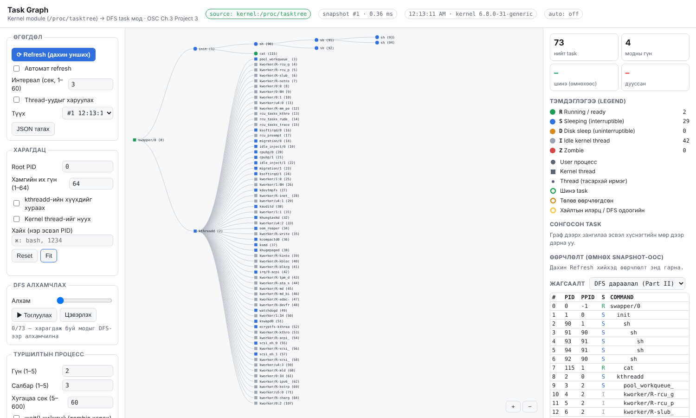
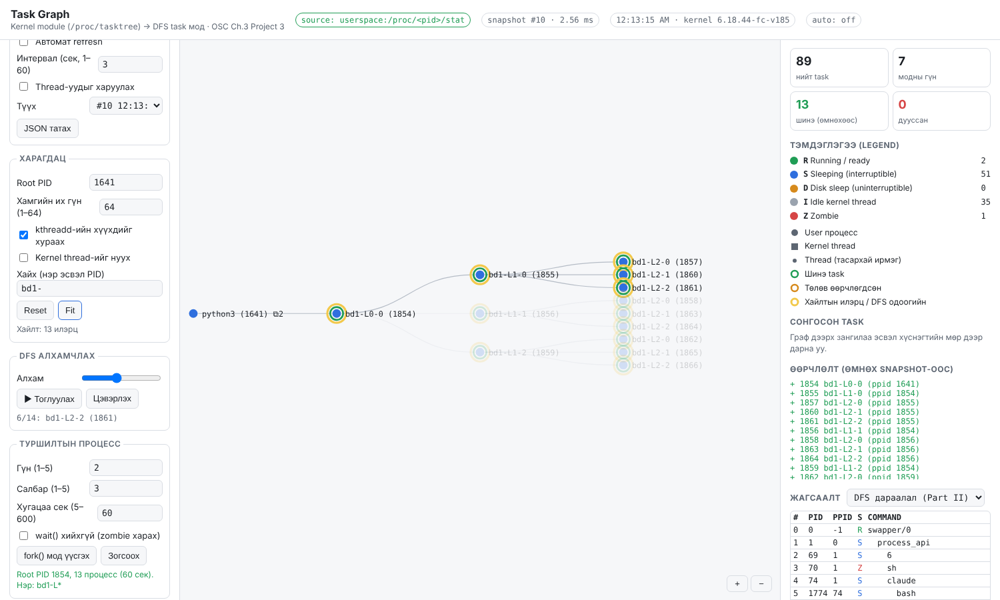
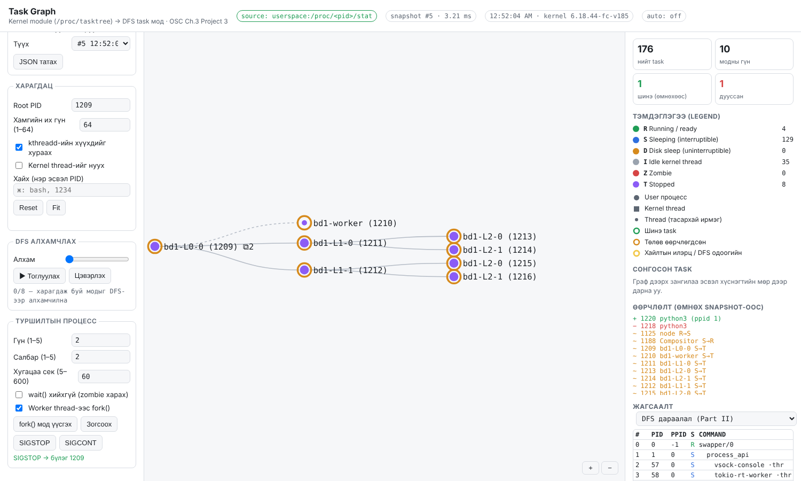
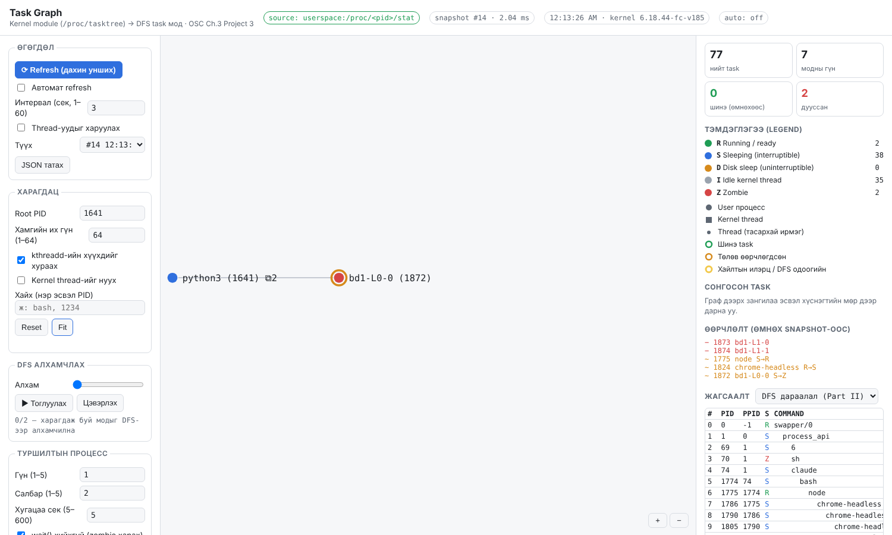
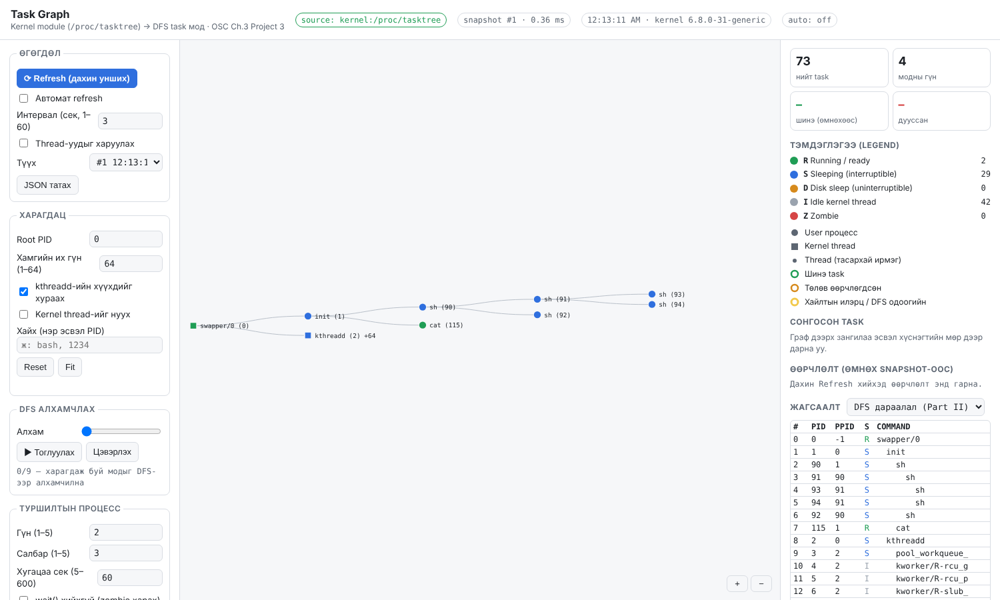
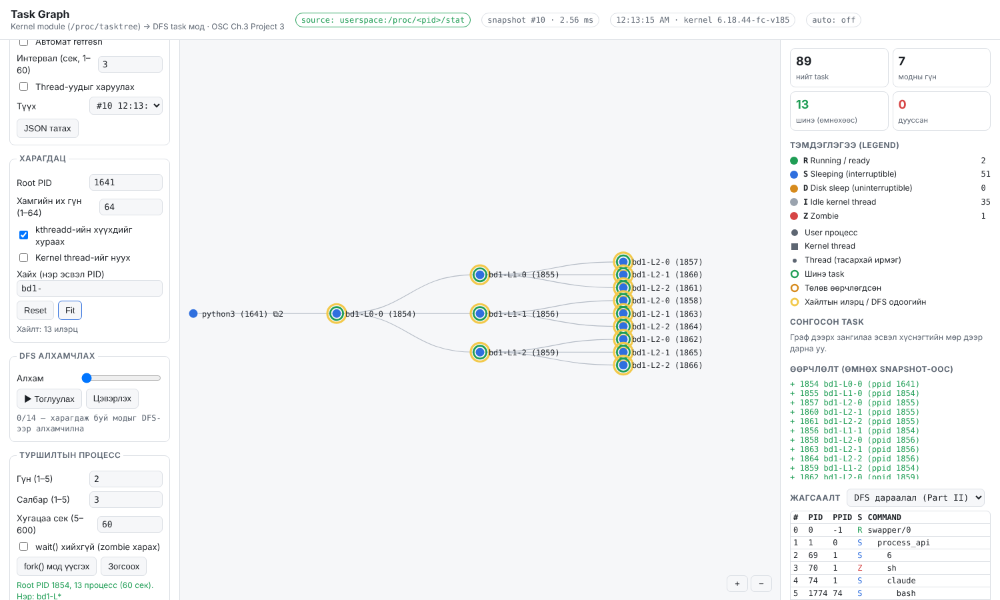

# Linux Kernel Module for Listing Tasks + Task Graph UI

> **F.CSM302 — Үйлдлийн систем | Бие даалт №1**  
> **Хуваарилалтын код:** `II-4-3`  
> **Сэдэв:** Linux Kernel Module for Listing Tasks  
> **UI дүрслэл:** Task Graph

## Төслийн тухай

Энэ төсөл нь Linux үйлдлийн системийн **процесс (task)-уудыг kernel түвшинд жагсаах**, процессын **эцэг–хүүхдийн хамаарлыг** судлах, үр дүнг **интерактив Task Graph** хэлбэрээр дүрслэх зорилготой.

Суурь даалгавар нь *Operating System Concepts* (10 дахь хэвлэл), **Бүлэг 3 — Processes**, *Programming Project 3: Linux Kernel Module for Listing Tasks* юм.

Төсөл дараах гурван хэсэгтэй:

1. **Linear listing:** `for_each_process()` ашиглан процессуудыг жагсаах kernel module.
2. **DFS listing:** `init_task`-аас эхлэн `children` / `sibling` холбоосоор процессын модыг гүнээр нь тойрох kernel module.
3. **Task Graph UI:** `/proc/tasktree`-ээс JSON snapshot авч, процессуудын PID, PPID, төлөв болон холбоосыг SVG графаар харуулах вэб интерфейс.

> **Анхаарах зүйл:** DFS-ийн дотоод хэрэгжүүлэлт (рекурсив эсвэл iterative) болон нэмэлт боломжуудыг эцсийн кодтой тулгаж баталгаажуулна. Энд алгоритмын зорилго, өгөгдлийн холбоосыг тайлбарласан.

## Багийн бүрэлдэхүүн

| Гишүүн | Оюутны код |
| :--- | :--- |
| М. Хуншагай | B242270134 |
| Т. Төгөлдөрчимэг | B241940117 |
| Г. Тэргэл | B242270048 |
| Б. Дэлгэрмөрөн | B210930009 |
| Г. Мөнхнайрамдал | B241910043 |
| П. Даваажаргал | B231940145 |

## Үндсэн боломжууд

### Kernel modules

| Module | Үүрэг |
| :--- | :--- |
| `tasklist_linear` | `for_each_process()`-оор процессуудыг шугаман жагсаах |
| `tasklist_dfs` | `init_task`-аас процессын модыг DFS зарчмаар тойрох |
| `tasktree` | `/proc/tasktree` интерфейсээр JSON snapshot гаргах |

`tasktree` module-ийн snapshot нь UI-д **Refresh** хийх үед процессын одоогийн бүтцийг шинэчлэхэд ашиглагдана.

### Task Graph UI

- Процессын **PID / PPID** болон эцэг–хүүхдийн холбоог графаар харуулах.
- Процессын төлөвийг ялгаж ажиглах: `R` (running/runnable), `S` (interruptible sleep), `D` (uninterruptible sleep), `T` (stopped/traced), `Z` (zombie), `I` (idle kernel thread — системээс хамаарна).
- **Refresh** — процессын snapshot-ыг дахин авах.
- **DFS дүрслэл** — процессын модоор гүйх дарааллыг алхамчилж ажиглах. Play/Pause/Step зэрэг удирдлагын бодит нэр, ажиллагааг ашиглаж буй UI хувилбартай тулгаж шалгана.
- Kernel module-гүй үед `userspace` болон бэлэн JSON файлаас өгөгдөл унших горим.

**Чухал:** UI-ийн DFS тоглуулалт нь **дүрслэлийн ажиллагаа** бөгөөд процессын kernel төлөвийг өөрчилдөггүй.

## Дэлгэцийн зургууд

Доорх зургууд `docs/img/` хавтсанд хадгалагдана. Ижил нэртэй PNG файлыг шинэ screenshot-оор соливол README доторх холбоос хэвээр ажиллана.

### 1. Kernel процессын бүтэн граф



### 2. DFS алхамчилсан дүрслэл



### 3. Процессын төлөв өөрчлөгдөх нь

| Түр зогсоосон процесс | Zombie процесс |
| :---: | :---: |
|  |  |

### 4. Нэмэлт туршилтууд

| Kernel snapshot | Процесс нэмэгдсэн үе |
| :---: | :---: |
|  |  |

Бусад screenshot-ууд: [`docs/img/`](docs/img/).

## Туршсан орчин

Доорх хүснэгтэд **төслийн өмнөх README-д бүртгэгдсэн** туршилтын мэдээллийг хадгалав. Шинэ kernel дээр хийсэн туршилтын үр дүнг баталгаажуулсны дараа тусад нь нэмнэ.

| Орчин | Kernel | Compiler | Өмнө бүртгэсэн үр дүн |
| :--- | :--- | :--- | :--- |
| Ubuntu 26.04.1 LTS (багийн VM) | `7.0.0-42-generic` | GCC 15 | QEMU `19/19 PASS` — `examples/qemu-ubuntu-26.04/` |
| Ubuntu 24.04 LTS | `6.8.0-31-generic` | GCC 13 | QEMU `19/19 PASS` — `examples/qemu/` |

Өөр kernel хувилбар ашиглахдаа тухайн системийн headers-тай дахин build хийнэ. Кодын нийцтэй байдлыг зорилтот kernel бүр дээр тусад нь шалгах шаардлагатай.

## Суулгах ба ажиллуулах

### 1. Шаардлагатай хэрэгслүүд

Ubuntu дээр:

```bash
sudo apt update
sudo apt install -y build-essential linux-headers-$(uname -r) python3
```

### 2. Repository татах

```bash
git clone https://github.com/B242270134/Uildliin_system_bd1.git tasklist-graph
cd tasklist-graph
```

### 3. Kernel module-уудыг build хийх

```bash
make -C src/kernel clean
make -C src/kernel
```

### 4. Linear listing турших

```bash
sudo insmod src/kernel/tasklist_linear.ko
sudo dmesg | tail -20
sudo rmmod tasklist_linear
```

### 5. DFS listing турших

```bash
sudo insmod src/kernel/tasklist_dfs.ko
sudo dmesg | tail -20
sudo rmmod tasklist_dfs
```

### 6. Kernel snapshot-оор UI ажиллуулах

```bash
sudo insmod src/kernel/tasktree.ko
python3 src/ui/server.py
```

Браузераас `http://127.0.0.1:8000` хаягийг нээнэ. Туршилтын дараа module-ийг буулгана:

```bash
sudo rmmod tasktree
```

### 7. Kernel module-гүйгээр UI турших

**Userspace mode:**

```bash
python3 src/ui/server.py --source userspace
```

**File mode:**

```bash
python3 src/ui/server.py --source file --file examples/snapshot1_kernel.json
```

Бэлэн автомат скрипт:

```bash
bash scripts/run_all.sh
```

> Kernel module ажиллуулахад тохирох Linux kernel headers болон `sudo` эрх шаардлагатай. `userspace` горим нь `/proc`-оос мэдээлэл уншдаг тул kernel module-ийн ажиллагааг дангаараа батлахгүй.

## Туршилт ба шалгалт

```bash
# Төслийн үндсэн тестүүд
bash tests/run_tests.sh

# DFS / Linear / ps харьцуулалт
python3 tests/compare_ps.py

# QEMU-д kernel турших (тохирох орчин шаардлагатай)
bash scripts/qemu_test.sh /boot/vmlinuz-$(uname -r)
```

Туршилтын тайланд дараах зүйлсийг ялгаж тэмдэглэнэ:

- **Kernel module:** `dmesg`, `/proc/tasktree`, module ачаалах/буулгах үр дүн.
- **Userspace UI:** `/proc` өгөгдлөөр граф дүрслэл ажилласан эсэх.
- **Процессын төлөв:** `R`, `S`, `T`, `Z`, `I`-г ажигласан баримт; `D` төлөвийг заавал хүчээр үүсгэх шаардлагагүй.
- **DFS:** процессын эцэг–хүүхдийн холбоо, тойрох дараалал, UI дүрслэл.

## Төслийн бүтэц

```text
Uildliin_system_bd1/
├── README.md
├── docs/
│   ├── MANUAL.md
│   └── img/                  # Task Graph screenshot-ууд
├── examples/                 # QEMU лог, snapshot, жишээ өгөгдөл
├── scripts/
│   ├── run_all.sh
│   └── qemu_test.sh
├── src/
│   ├── kernel/
│   │   ├── tasklist_linear.c
│   │   ├── tasklist_dfs.c
│   │   ├── tasktree.c
│   │   ├── common.h
│   │   └── Makefile
│   └── ui/
│       ├── server.py
│       └── index.html
└── tests/                    # Автомат болон туслах тестүүд
```

## Тайлбар ба хязгаарлалт

- Процессын жагсаалт динамик тул хоёр дараалсан snapshot-ийн PID болон модны бүтэц өөр байж болно.
- Kernel thread-үүд болон төлөвийн тэмдэглэгээ kernel хувилбараас хамааран ялгаатай харагдаж болно.
- `userspace` mode болон `kernel` mode нь өгөгдөл авах өөр арга тул үр дүнг тусад нь тайлбарлана.
- Screenshot-ууд нь тухайн мөчийн туршилтын баримт бөгөөд бүх орчинд ижил PID эсвэл процессын тоо гарахгүй.

## Ашигласан материал

- Silberschatz, Galvin, Gagne — *Operating System Concepts*, 10th Edition, Wiley, 2018, Chapter 3: Processes, Programming Project 3.

